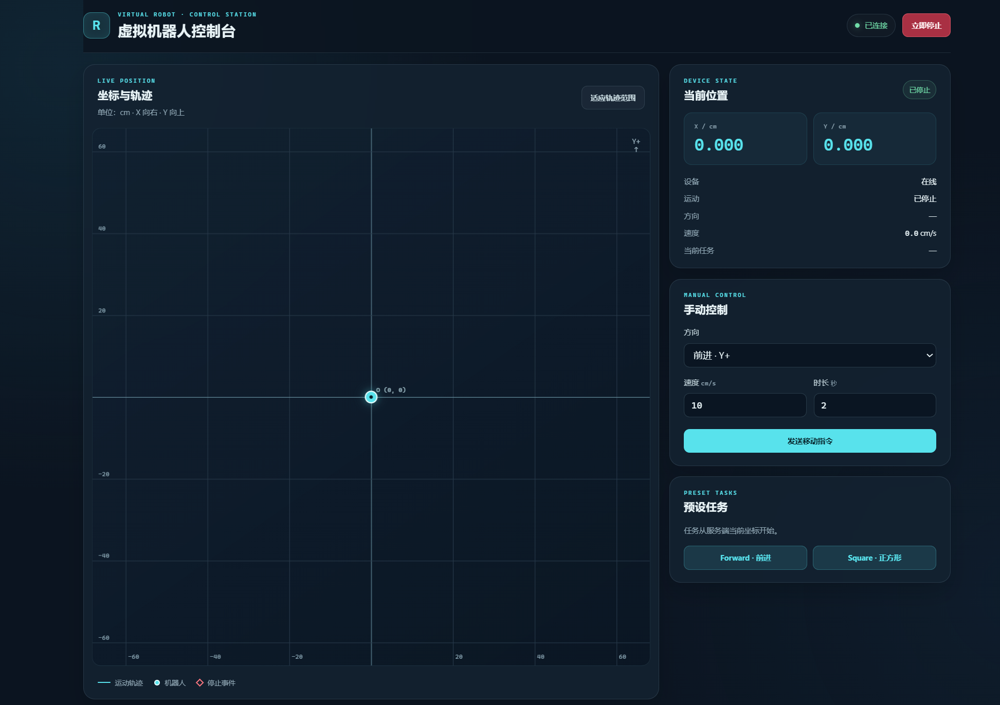
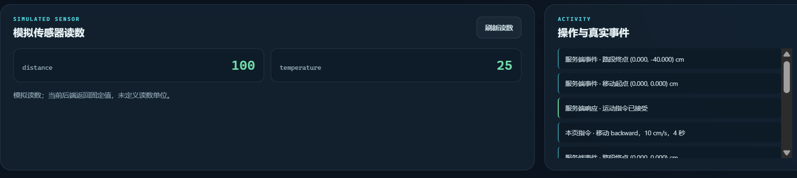

# Virtual Robot IoT｜虚拟机器人控制台

一个运行在 Ubuntu 上的虚拟机器人设备服务。Windows 电脑通过局域网打开浏览器，就能查看机器人状态、发送移动或预设任务指令，并在坐标图上观察位置与轨迹。

项目仓库：[gugu-hkl/virtual-robot-IoT](https://github.com/gugu-hkl/virtual-robot-IoT)

## 界面预览





## 项目能做什么

- **跨设备访问：**Ubuntu 运行 FastAPI，提供网页和 API；Windows 只需浏览器，无需安装客户端程序。
- **状态与坐标查询：**查看设备在线状态、运动方向、速度、当前任务及二维坐标。
- **定时移动与停止：**指定方向、速度和时长；运动过程中可以随时停止，机器人停在当时的位置。
- **预设任务：**从当前坐标执行 `forward` 或 `square`，并记录运动轨迹。
- **网页可视化：**Canvas 绘制坐标轴、轨迹、机器人位置和轨迹事件；页面定时查询服务端状态。
- **模拟传感器：**展示 `/sensor` 返回的固定示例数据。

数据流：`Windows 浏览器 → 局域网 HTTP 请求 → Ubuntu FastAPI → Robot 状态 → JSON 响应 → 网页更新`。坐标与运动状态由服务端维护，网页负责控制和展示。

## 运行环境

| 部分 | 要求 |
| --- | --- |
| 服务端 | Ubuntu、Python 3.10+、可用的 `python3-venv` |
| Python 依赖 | 见仓库中的 `requirements.txt`；当前包含 FastAPI 0.143.0、Uvicorn 0.54.0 |
| 客户端 | Windows 上的现代浏览器，如 Edge 或 Chrome |
| 网络 | Windows 能访问 Ubuntu 虚拟机的 IP 和 8000 端口 |

前端使用原生 HTML、CSS、JavaScript 和 Canvas，无需 Node.js 或前端构建步骤。

## 启动服务

在 **Ubuntu** 终端执行：

```bash
git clone https://github.com/gugu-hkl/virtual-robot-IoT.git
cd virtual-robot-IoT

python3 -m venv .venv
source .venv/bin/activate
python -m pip install -r requirements.txt

python -m uvicorn main:app --host 0.0.0.0 --port 8000
```

如果已经克隆仓库，从 `cd virtual-robot-IoT` 开始即可。首次创建虚拟环境若提示缺少 `venv`，先在 Ubuntu 安装对应的 `python3-venv` 包。

服务启动后，在 Ubuntu 本机可打开 `http://127.0.0.1:8000/`。需要确认虚拟机 IP 时，可在 Ubuntu 运行 `hostname -I`，选取 Windows 能访问的地址。

在 **Windows 浏览器**中打开：

```text
http://<Ubuntu虚拟机IP>:8000/
```

接口调试页面：`http://<Ubuntu虚拟机IP>:8000/docs`。页面和 API 由同一个服务提供，Windows 不需要运行 Python。

> 本项目的机器人状态保存在服务进程内存中。请使用单个 Uvicorn worker；重启服务后坐标和轨迹会从原点重新开始。

## 接口说明

坐标单位为 **cm**：`x` 正方向向右，`y` 正方向向上。`speed` 的单位是 **cm/s**，`duration_s` 的单位是秒。

| 方法 | 路径 | 功能 | 请求体 |
| --- | --- | --- | --- |
| `GET` | `/status` | 获取在线与运动状态、当前坐标及轨迹 | 无 |
| `GET` | `/sensor` | 获取固定的模拟传感器读数 | 无 |
| `POST` | `/move` | 按方向、速度和时长开始运动 | `direction`、`speed`、`duration_s` |
| `POST` | `/stop` | 停在调用时的当前位置 | 无 |
| `POST` | `/task` | 从当前坐标开始预设任务 | `name` |

### `GET /status`

返回字段包括：

- `online`：设备在线状态。
- `moving`：是否正在运动。
- `direction`：当前方向；停止时为 `null`。
- `speed`：当前速度；停止时为 `0`。
- `current_task`：正在执行的预设任务；没有任务时为 `null`。
- `position`：当前 `{ "x": ..., "y": ... }` 坐标。
- `trajectory`：轨迹点列表，每个点包含 `x`、`y` 和 `event`。

初次启动、尚未发送指令时，返回数据形如：

```json
{
  "online": true,
  "moving": false,
  "direction": null,
  "speed": 0,
  "current_task": null,
  "position": {"x": 0.0, "y": 0.0},
  "trajectory": [{"x": 0.0, "y": 0.0, "event": "start"}]
}
```

实际坐标和轨迹会随操作变化。当前轨迹事件包括 `start`、`move`、`progress`、`segment_end`、`stop`、`task:forward` 和 `task:square`。

### `GET /sensor`

当前返回固定模拟数据：

```json
{"distance": 100, "temperature": 25}
```

这两个数值不是硬件测量值，当前后端也未定义它们的单位。

### `POST /move`

请求示例：

```json
{"direction": "forward", "speed": 10, "duration_s": 2}
```

`direction` 可选 `forward`（Y+）、`backward`（Y−）、`left`（X−）、`right`（X+）；`speed` 必须大于 0 且不超过 100；`duration_s` 必须大于 0 且不超过 60。上例表示沿 Y 正方向以 10 cm/s 运动 2 秒。接口返回 `message` 和操作后的 `status`；运动位置会随着经过的时间更新。

### `POST /stop`

无需请求体。服务端先计算已经走过的距离，再停止运动；返回 `message` 和停止后的 `status`。

### `POST /task`

请求示例：

```json
{"name": "square"}
```

支持两个任务：

| 任务名 | 行为 |
| --- | --- |
| `forward` | 从当前坐标沿 Y+ 前进 20 cm |
| `square` | 从当前坐标依次沿 Y+、X+、Y−、X− 各走 20 cm，最后回到任务起点 |

预设任务使用 10 cm/s 的固定速度，每条 20 cm 路段需约 2 秒。`/task` 的响应表示任务已开始；可继续查询 `/status` 观察过程，或调用 `/stop` 提前停止。

## 演示步骤

1. 在 Ubuntu 启动服务，在 Windows 浏览器打开首页，确认显示“已连接”和坐标原点。
2. 发送 `forward`、`10 cm/s`、`2 秒` 的移动指令，观察坐标向 Y+ 变化，约 2 秒后停在 `(0, 20)` cm 附近。
3. 点击 `Square`，观察从当前坐标画出四条边，并返回任务开始的位置。
4. 发起较长时间的移动，途中点击“立即停止”，确认坐标停在响应返回的位置。
5. 查看页面下方的模拟传感器读数和操作记录；也可以打开 `/docs` 分别调用五个接口。

## 项目结构

```text
virtual-robot-IoT/
├── main.py           # FastAPI 入口、5 个 API 和网页路由
├── robot.py          # 机器人状态、坐标与任务模拟
├── requirements.txt  # Python 依赖
├── web/
│   ├── index.html    # 页面结构
│   ├── style.css     # 页面样式
│   └── app.js        # 请求、交互和 Canvas 绘图
└── README.md
```

## 当前范围

这是**虚拟设备**项目，没有连接真实机器人。位置根据指令、速度和经过的时间计算；`/sensor` 是固定模拟数据。状态和轨迹保存在单个服务进程的内存里，重启后重置；当前也没有服务端时间戳、任务完成百分比或真实障碍物检测。

如果 Windows 无法打开页面，先确认 Ubuntu 服务仍在运行、使用了 `--host 0.0.0.0`，再检查虚拟机 IP、网络模式和 8000 端口的连通性。
