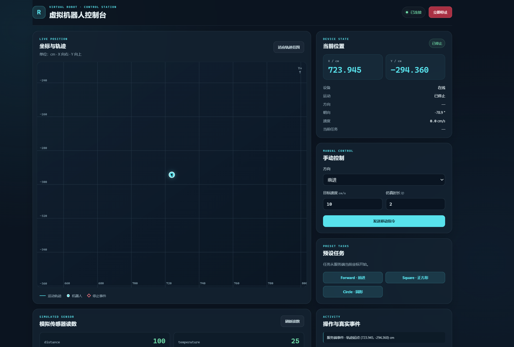
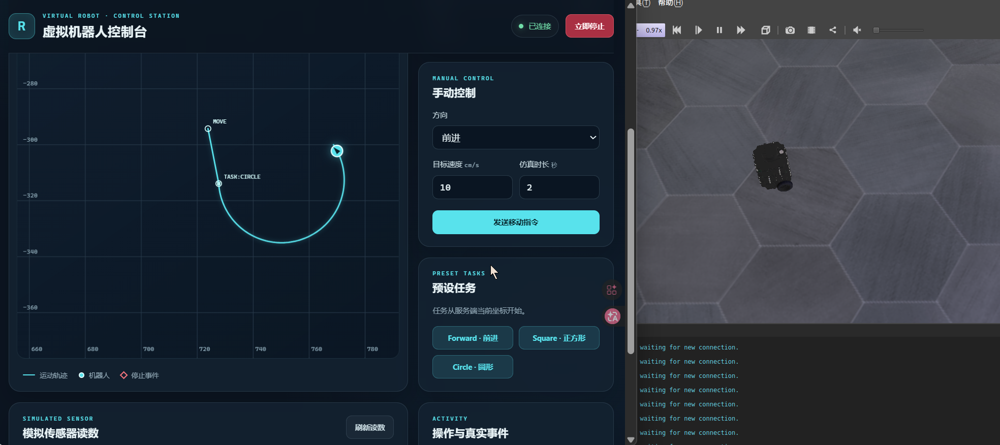
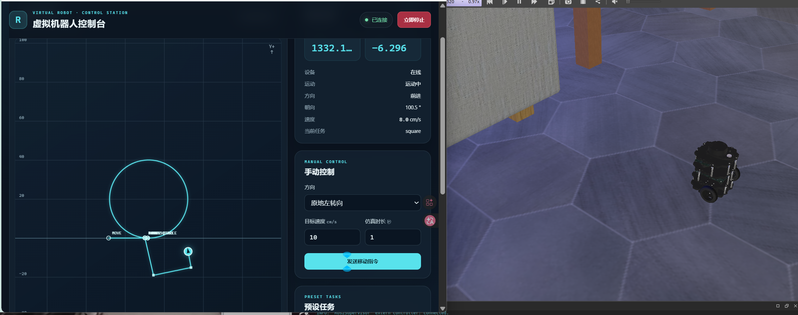
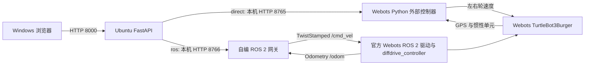

# Virtual Robot IoT

在 Ubuntu 的 Webots 中运行 TurtleBot3Burger，使用 Windows 浏览器查看位置、发送运动指令和执行预设轨迹。项目提供两种可切换的控制链路：FastAPI 通过自编 Webots 外部控制器直接驱动车轮，或经自编 ROS 2 节点发布 `/cmd_vel` 并订阅 `/odom`。两种模式共用网页和五个 HTTP 接口。

> 当前 README 对应仓库的第二阶段实现。第一阶段的 `robot.py` 内存模拟器仍保留在仓库中，但当前 `main.py` 使用的是 Webots 或 ROS 2 后端；仅启动 FastAPI 不会自动启动仿真机器人。

第三阶段正在开发双机器人与无线显示：双机器人启动见 [第一步说明](docs/stage3_01_dual_robot.md)，分别查询 a/b 状态见 [第二步说明](docs/stage3_02_dual_status.md)，ESP32 通过 Wi-Fi 在 OLED 上显示所选机器人状态见 [第三步说明](docs/stage3_03_wireless_oled.md)。第三阶段使用仓库中的 `dual_turtlebot.wbt`；下文第二阶段单机器人演示仍使用系统安装的官方示例世界。

## 演示画面

网页显示坐标、轨迹、朝向、手动控制、预设任务和操作记录。Windows 只需要浏览器。



| FastAPI 直接控制 Webots | FastAPI 经 ROS 2 控制 Webots |
| --- | --- |
|  |  |

## 功能与数据流

- **手动控制：**前进、后退、原地左转、原地右转；指定轮缘目标速度（cm/s）和仿真时长（秒），可随时发送停止指令。
- **预设任务：**`forward` 前进约 20 cm、`square` 绘制四条约 20 cm 的边、`circle` 绘制约 20 cm 半径的圆弧。任务从当前机器人位置和朝向开始，执行过程中使用仿真反馈推进。
- **状态可视化：`/status`，绘制坐标与轨迹；显示服务端返回的位置、朝向、运动状态和任务状态。
- **接口兼容：**两种后端复用 `GET /status`、`GET /sensor`、`POST /move`、`POST /stop`、`POST /task`。 



`ROBOT_BACKEND=direct` 或 `ROBOT_BACKEND=ros` 在启动 FastAPI 时选择后端；默认是 `direct`。图中的两条链路是**二选一**的运行方式：切换时要关闭前一模式的控制器、Webots 实例和 FastAPI，再按新模式的顺序启动。`8765` 与 `8766` 只监听 Ubuntu 本机 `127.0.0.1`；Windows 访问 `8000` 端口。

直连模式的位置取自 Webots GPS 的世界坐标，ROS 2 模式的位置取自 `/odom` 的里程计坐标。
## 运行环境

| 位置 | 依赖 |
| --- | --- |
| Ubuntu 服务端 | Ubuntu 24.04、Python 3、`python3-venv`、Webots R2025a、ROS 2 Jazzy、`webots_ros2_turtlebot` |
| Python 环境 | `requirements.txt`；其中 FastAPI 为 0.143.0、Uvicorn 为 0.54.0 |
| ROS 2 工作空间 | `colcon`、`rclpy`、`geometry_msgs`、`nav_msgs`；ROS 依赖由系统环境提供 |
| Windows 客户端 | Edge、Chrome 等现代浏览器；与 Ubuntu 虚拟机网络互通 |

前端使用原生 HTML、CSS、JavaScript 和 Canvas。示例世界 `turtlebot3_burger_example.wbt` 来自已安装的 `webots_ros2_turtlebot` 软件包，**不在本仓库中**。Webots 安装目录在本文命令中按 `/usr/local/webots` 编写；若你的安装位置不同，修改 `WEBOTS_HOME`。

### 克隆并准备 Python 环境

在 **Ubuntu** 终端执行：

```bash
git clone https://github.com/gugu-hkl/virtual-robot-IoT.git
cd virtual-robot-IoT
python3 -m venv .venv
source .venv/bin/activate
python -m pip install -r requirements.txt
```

如果已克隆仓库，在实际仓库根目录执行创建虚拟环境及安装依赖的命令即可。下面各终端示例假设仓库位于 `~/virtual-robot-IoT`；如果你克隆到了其他位置，替换相应的 `cd` 路径。

## 启动模式一：FastAPI 直接控制 Webots

此模式复用官方软件包提供的 TurtleBot 世界，但**不通过 ROS 2 话题驱动车轮**；本项目的 `stage2/direct_controller.py` 作为 Webots 外部控制器连接机器人。

**终端 A：**定位示例世界，确认机器人配置为外部控制器，然后打开 Webots。

```bash
source /opt/ros/jazzy/setup.bash
export WEBOTS_HOME=/usr/local/webots
WORLD="$(ros2 pkg prefix --share webots_ros2_turtlebot)/worlds/turtlebot3_burger_example.wbt"
grep -n -C 3 'controller "<extern>"' "$WORLD"
"$WEBOTS_HOME/webots" "$WORLD"
```

**终端 B：**连接自编控制器。Webots 应显示 `TurtleBot3Burger`，终端应打印机器人名、仿真步长与持续更新的 GPS 位置。

```bash
cd ~/virtual-robot-IoT
export WEBOTS_HOME=/usr/local/webots
"$WEBOTS_HOME/webots-controller" \
  --robot-name=TurtleBot3Burger "$PWD/stage2/direct_controller.py"
```

**终端 C：**启动 FastAPI。

```bash
cd ~/virtual-robot-IoT
source .venv/bin/activate
ROBOT_BACKEND=direct python -m uvicorn main:app --host 0.0.0.0 --port 8000
```

## 启动模式二：FastAPI 经 ROS 2 控制 Webots

先关闭直连模式的 FastAPI、外部控制器和 Webots 实例。此模式由官方 `ros2 launch` 启动 Webots 驱动，本项目的 ROS 2 网关发布 `geometry_msgs/msg/TwistStamped` 到 `/cmd_vel`，订阅 `nav_msgs/msg/Odometry` 的 `/odom`。

**首次使用或代码更新后：**构建本仓库的 ROS 2 包。

```bash
cd ~/virtual-robot-IoT/ros2_ws
source /opt/ros/jazzy/setup.bash
colcon build --packages-select robot_ros_bridge --symlink-install
```

**终端 A：**启动官方 TurtleBot 示例及 Webots 驱动。

```bash
source /opt/ros/jazzy/setup.bash
ros2 launch webots_ros2_turtlebot robot_launch.py
```

**终端 B：**运行自编 ROS 2 网关。它在 Ubuntu 本机提供 `127.0.0.1:8766`，并且使用仿真时钟。

```bash
source /opt/ros/jazzy/setup.bash
source ~/virtual-robot-IoT/ros2_ws/install/setup.bash
ros2 run robot_ros_bridge ros_gateway --ros-args -p use_sim_time:=true
```

**终端 C：**用 ROS 后端启动 FastAPI。

```bash
cd ~/virtual-robot-IoT
source .venv/bin/activate
ROBOT_BACKEND=ros python -m uvicorn main:app --host 0.0.0.0 --port 8000
```

可在另一个已加载 ROS 环境的终端核对话题和控制器：

```bash
ros2 topic type /cmd_vel
ros2 topic type /odom
ros2 control list_controllers
ros2 topic echo /odom --once
```

本项目已核对的 Jazzy 环境中，`/cmd_vel` 为 `geometry_msgs/msg/TwistStamped`，`/odom` 为 `nav_msgs/msg/Odometry`，`diffdrive_controller` 处于 `active`。若你的安装版本返回不同类型，应先以本机结果为准核查配置。

### 单独验证 Publisher 与 Subscriber

这一步用于检查自编 ROS 2 节点。保持官方 Webots 示例运行，并在新终端加载工作空间：

```bash
source /opt/ros/jazzy/setup.bash
source ~/virtual-robot-IoT/ros2_ws/install/setup.bash
ros2 run robot_ros_bridge state_subscriber
```

再开一个终端运行 Publisher：

```bash
source /opt/ros/jazzy/setup.bash
source ~/virtual-robot-IoT/ros2_ws/install/setup.bash
ros2 run robot_ros_bridge command_publisher \
  --linear 0.08 --angular 0 --duration 4 \
  --ros-args -p use_sim_time:=true
```

Publisher 的 `--linear` 单位是 m/s，`--angular` 单位是 rad/s；网页 `/move` 的 `speed` 单位则是 cm/s。Subscriber 应显示 `/odom` 中的位置、朝向及速度变化。

## Windows 访问与接口

在 Ubuntu 执行 `hostname -I` 找到 Windows 可以访问的虚拟机 IP，然后在 **Windows 浏览器**打开：

```text
http://<Ubuntu虚拟机IP>:8000/
```

第一页是控制台，第二页是 FastAPI 接口调试页。若页面打不开，先在 Ubuntu 本机检查 `http://127.0.0.1:8000/status`，再检查虚拟机网络和 8000 端口。

`direction` 只能是 `forward`、`backward`、`left`、`right`。`speed` 范围为大于 0 且不超过 20 cm/s；直连模式还会按 Webots 电机的实际速度上限检查。`duration_s` 范围为大于 0 且不超过 60 仿真秒。任务名支持 `forward`、`square`、`circle`。

`/status` 的共用字段包括 `online`、`moving`、`direction`、`speed`、`current_task`、`task_phase`、`last_task_result`、`position`（`x`、`y`，单位 cm）、`trajectory`（含 `x`、`y`、`event`）、`yaw_deg` 和 `simulation_time_s`。直连模式另有 `world_z_m`；ROS 模式另有 `backend`、`position_source`、`odom_frame` 和 `measured_speed_cm_s`。`/move`、`/stop`、`/task` 返回 `message` 和当时的 `status`。

控制接口的成功响应表示指令已由当前后端接收并处理，**不代表整段运动或整个任务已经完成**。应继续查看 Webots 画面和 `/status` 的位置、轨迹与 `last_task_result`。两种后端都可能因仿真未运行或状态数据过期返回 `503`；参数无效时返回 `422`。

## 最短验收流程

1. 按所选模式启动三个终端，在 Windows 打开控制台与 `/docs`，确认 `/status` 返回位置与朝向；Webots 画面中能看到 TurtleBot3Burger。
2. 分别发送前进、后退、原地左转、原地右转。前后运动检查位置变化；原地转向主要检查 `yaw_deg`，位置可能基本不变。
3. 发出较长的 `/move` 或 `/task`，执行中调用 `/stop`，观察机器人停下，并在后续 `/status` 中核对当前位置与任务结果。
4. 分别运行 `square` 和 `circle`；同时观察 Webots 中的实际运动和网页轨迹，等待任务完成后检查 `last_task_result` 与轨迹事件。轨迹是仿真反馈的采样结果，形状可能存在误差。
5. 完全停止当前模式后切换 `ROBOT_BACKEND`，用另一条链路重复状态查询与控制测试。ROS 2 模式还可用 `ros2 topic echo /odom --once` 检查里程计。

## 仓库结构

```text
virtual-robot-IoT/
├── main.py                         # FastAPI 网页入口和五个公共接口
├── requirements.txt                # FastAPI Python 环境依赖
├── web/                            # HTML、CSS、JavaScript、Canvas 页面
├── docs/images/                    # 本 README 的演示截图（复制交付文件时一并放入）
├── stage2/
│   ├── backend_bridge.py           # 根据 ROBOT_BACKEND 选择 8765 或 8766
│   ├── direct_controller.py        # Webots 外部控制器、GPS、车轮与任务
│   └── webots_bridge.py            # 早期直连桥接代码；当前 main.py 不使用
├── ros2_ws/src/robot_ros_bridge/
│   ├── setup.py                     # ROS 2 可执行入口
│   └── robot_ros_bridge/
│       ├── command_publisher.py    # /cmd_vel 发布节点
│       ├── state_subscriber.py      # /odom 订阅节点
│       └── ros_gateway.py           # 本机 HTTP 网关与 ROS 2 任务状态
├── robot.py                         # 第一阶段内存模拟器代码
└── README.md
```

`/sensor` 的 `distance=100`、`temperature=25` 是固定示例值，当前未定义单位，也没有真实障碍物检测。直连模式使用 Webots GPS 与惯性单元；ROS 2 模式使用 `/odom` 里程计，后者是估计状态。轨迹保存在运行中的后端进程内存中，重启仿真或网关后会重新开始。

## 参考

- [Webots ROS 2 官方仓库](https://github.com/cyberbotics/webots_ros2)
- [官方 TurtleBot 示例启动文件](https://github.com/cyberbotics/webots_ros2/blob/master/webots_ros2_turtlebot/launch/robot_launch.py)
