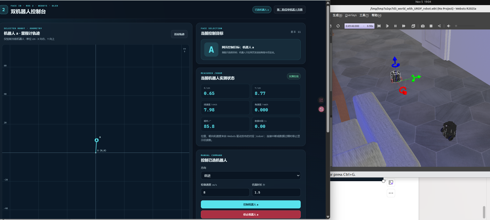
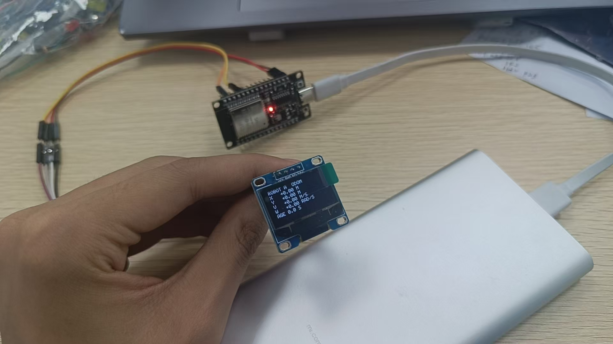
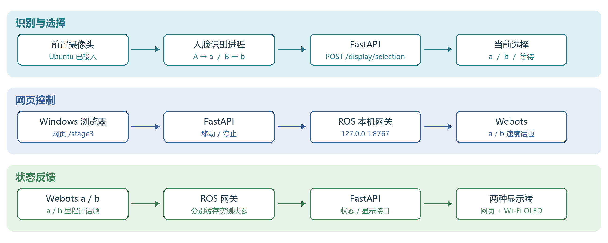
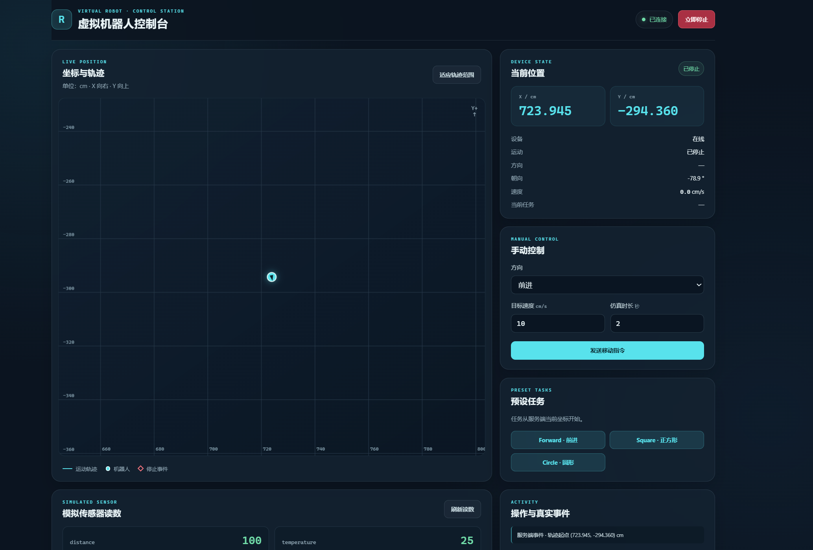
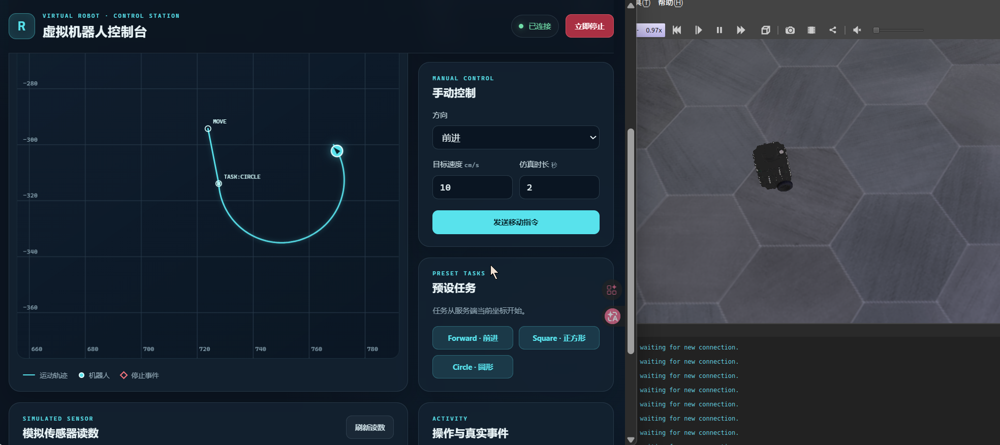
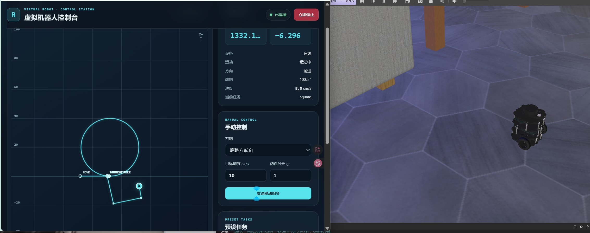
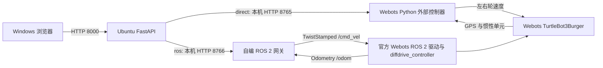

# Virtual Robot IoT

这是一个分阶段完成的物联网机器人项目。最终版本在 Ubuntu 中运行 Webots 双机器人、ROS 2、FastAPI 和人脸识别；Windows 只用浏览器控制；ESP32 通过 Wi-Fi 把当前选中机器人的运动状态显示在 OLED 上。

**最终演示链路：**刷脸选 a/b → 网页控制被选中的机器人 → Webots 中对应机器人运动 → `/a/odom` 或 `/b/odom` 更新 → 网页和 OLED 显示新状态。刷脸只选择目标，机器人运动由网页按钮触发；第三阶段没有“识别后自动执行轨迹”的功能。

## 演示效果

下图是 Windows 控制台与 Webots 的同屏画面。网页坐标图展示当前选中机器人的里程计轨迹，右侧显示实测位置、速度和手动控制。



ESP32 独立通过 Wi-Fi 查询 FastAPI，在 OLED 上显示机器人标号、X/Y 位置、线速度、角速度和数据年龄：



## 系统架构



| 进程或设备 | 职责 |
| --- | --- |
| Ubuntu 人脸识别进程 | 读取接入虚拟机的摄像头，稳定识别 A/B 后调用 `POST /display/selection`，分别选择 a/b |
| Windows 浏览器 | 打开 `/stage3`；查看 a/b 状态，只向当前选中机器人发送运动指令 |
| Ubuntu FastAPI | 提供网页和 HTTP API，保存选择版本，切换目标时尝试停止上一台机器人 |
| 双机器人 ROS 2 网关 | 本机监听 `127.0.0.1:8767`；分别发布 `/a/cmd_vel`、`/b/cmd_vel`，订阅 `/a/odom`、`/b/odom` |
| Webots | 在仓库的 `dual_turtlebot.wbt` 世界中仿真机器人 a 和 b |
| ESP32 + OLED | 经同一 Wi-Fi 热点轮询 `/display/state`，显示当前目标的实时状态或连接错误 |

控制话题在本项目的 ROS 2 Jazzy 环境中使用 `geometry_msgs/msg/TwistStamped`；状态话题使用 `nav_msgs/msg/Odometry`。`/odom` 是各机器人独立的里程计估计，a 与 b 的坐标原点不能当成同一张世界地图。Webots 暂停或状态超过 2 秒没有新时间戳时，接口报告数据过期。

## 环境与硬件

| 项目 | 已验收配置 |
| --- | --- |
| Ubuntu | Ubuntu 24.04、ROS 2 Jazzy、Webots R2025a、`webots_ros2_turtlebot`、`colcon` |
| FastAPI | Python 虚拟环境 `.venv`，依赖见 `requirements.txt` |
| 人脸识别 | 独立虚拟环境 `.venv-face`，OpenCV、NumPy、YuNet 与 SFace 模型 |
| Windows | 浏览器访问 Ubuntu 的热点 IP；前置摄像头已接入 Ubuntu 虚拟机 |
| 无线终端 | 经典 ESP32；ESP-IDF 6.1 开发版；1.30 英寸 128×64 SSD1315 OLED，I²C 地址 `0x3C` |

OLED 接线：`VCC → 3V3`、`GND → GND`、`SDA → GPIO21`、`SCK/SCL → GPIO22`。Windows、桥接网络下的 Ubuntu 和 ESP32 需要接入同一热点；只有 FastAPI 的 `8000` 端口供局域网访问，ROS 网关的 `8767` 端口只监听 Ubuntu 本机。

## 快速启动第三阶段

以下命令在 **Ubuntu** 执行。示例假设仓库克隆在 `~/virtual-robot-IoT`；已有仓库时改用实际路径。首次部署先准备 Python 环境和人脸模板：

```bash
git clone https://github.com/gugu-hkl/virtual-robot-IoT.git
cd virtual-robot-IoT

python3 -m venv .venv
source .venv/bin/activate
python -m pip install -r requirements.txt
deactivate

python3 -m venv .venv-face
source .venv-face/bin/activate
python -m pip install -r stage3/face_id/requirements.txt
python -m stage3.face_id.download_models
python -m stage3.face_id.enroll --person A --camera 0
python -m stage3.face_id.enroll --person B --camera 0
deactivate
```

注册 A/B 时每次只让一人入镜。若摄像头编号不是 `0`，在注册与正式识别命令中使用实际编号。模型和人脸模板仅保存在本机，仓库的 `.gitignore` 已排除这些文件。

**ESP32 首次刷入或热点地址变化时**，在 Ubuntu 的 ESP-IDF 终端执行：

```bash
. ~/esp/esp-idf/export.sh
cd ~/virtual-robot-IoT/stage3/esp32_oled
idf.py set-target esp32
idf.py menuconfig
idf.py build
idf.py -p /dev/ttyUSB0 flash monitor
```

在 `Robot OLED terminal` 菜单填写热点 SSID、密码和 `http://<Ubuntu热点IP>:8000/display/state`；保留 SDA 21、SCL 22、地址 `0x3C`。串口路径按实际设备替换。`sdkconfig` 含热点密码，已被忽略，不要上传。

之后打开四个 Ubuntu 终端，依次启动：

**终端 A：双机器人世界。**

```bash
source /opt/ros/jazzy/setup.bash
cd ~/virtual-robot-IoT/ros2_ws
colcon build --packages-select robot_ros_bridge --symlink-install
source install/setup.bash
ros2 launch robot_ros_bridge dual_turtlebot.launch.py
```

**终端 B：自编 ROS 2 状态与控制网关。**

```bash
source /opt/ros/jazzy/setup.bash
cd ~/virtual-robot-IoT/ros2_ws
source install/setup.bash
ros2 run robot_ros_bridge dual_state_gateway --ros-args -p use_sim_time:=true
```

**终端 C：FastAPI。**只运行一个 Uvicorn 进程，不加 `--workers`，因为当前选择保存在进程内存中。

```bash
cd ~/virtual-robot-IoT
source .venv/bin/activate
ROBOT_BACKEND=ros python -m uvicorn main:app --host 0.0.0.0 --port 8000
```

**终端 D：人脸识别与 Ubuntu 实时预览。**

```bash
cd ~/virtual-robot-IoT
source .venv-face/bin/activate
python -m stage3.face_id.run --camera 0 --preview
```

在 Ubuntu 执行 `hostname -I` 找到热点 IP，然后在 Windows 浏览器打开 `http://<Ubuntu热点IP>:8000/stage3`。ESP32 使用同一 IP 请求 `/display/state`；不能把设备的服务地址设成 `127.0.0.1`。

## 最短验收

1. Webots 同时出现 a、b；`ros2 topic list -t` 中有两套 `/cmd_vel` 和 `/odom`；`GET /robots/a/status`、`GET /robots/b/status` 分别返回新鲜状态。
2. 无人入镜时，网页等待选择、移动按钮不可用，OLED 显示 `WAIT SELECT`。
3. A 稳定入镜后，预览窗口显示 `FACE: A`、`TARGET: a`、`API ACK: a`，网页选中 a，OLED 显示 `ROBOT A`。在网页发送前进，只有 a 运动；网页和 OLED 的 a 状态随 `/a/odom` 更新。
4. B 稳定入镜后，网页与 OLED 切到 b。在网页发送原地左转，只有 b 转动；b 的朝向和角速度更新。分别点击停止按钮后，检查对应 `/odom` 的实测速度趋近零。
5. 暂停 Webots 超过 2 秒，状态接口返回过期错误，网页禁用移动，OLED 显示 `DATA STALE`；恢复仿真后状态重新更新。未知人脸或多人同框不会随意切换目标。

## 第三阶段 API

| 路由 | 用途 |
| --- | --- |
| `GET /display/selection` | 查询当前选中机器人、`selection_revision` 和停止警告 |
| `POST /display/selection` | 人脸进程提交 `{"robot_id":"a"}`、`{"robot_id":"b"}` 或 `null` |
| `GET /robots/{id}/status` | 分别读取 a/b 的位置、朝向、实测线速度、角速度与数据年龄 |
| `POST /robots/{id}/move` | 控制当前选中机器人；提交 `direction`、`speed`、`duration_s` 和 `selection_revision` |
| `POST /robots/{id}/stop` | 单独停止 a 或 b，不要求该机器人当前被选中 |
| `GET /display/state` | ESP32 轮询当前目标的显示状态 |

`direction` 可为 `forward`、`backward`、`left`、`right`。第三阶段网关接受 `0 < speed ≤ 20` cm/s、`0 < duration_s ≤ 10` 仿真秒。旧选择版本的移动请求返回 `409`；状态过期或网关不可用时返回错误，不把旧数据当作实时读数。控制响应中的 `accepted: true` 只表示指令被接收，实际运动还要看 Webots 和后续 `/odom`。

## 前两个阶段

- **第一阶段：**`robot.py` 保存纯 Python 虚拟机器人状态；当前 `main.py` 已连接 Webots/ROS 后端，单独运行 FastAPI 不会自动启动仿真。
- **第二阶段：**单机器人 TurtleBot3Burger 可用自编 Webots 外部控制器直接控制，或经自编 ROS 2 Publisher/Subscriber 控制；两种模式复用旧首页 `/` 与 `/status`、`/sensor`、`/move`、`/stop`、`/task`。第二阶段的 `square`、`circle` 是单机器人预设任务，**第三阶段刷脸不会自动触发这些任务**。

第三阶段双机器人世界和第二阶段单机器人链路分别启动；不要让两个控制链路同时连接同一个机器人。以下保留第二阶段的独立启动说明。

---

## 第二阶段演示画面

网页显示坐标、轨迹、朝向、手动控制、预设任务和操作记录。Windows 只需要浏览器。



| FastAPI 直接控制 Webots | FastAPI 经 ROS 2 控制 Webots |
| --- | --- |
|  |  |

## 第二阶段功能与数据流

- **手动控制：**前进、后退、原地左转、原地右转；指定轮缘目标速度（cm/s）和仿真时长（秒），可随时发送停止指令。
- **预设任务：**`forward` 前进约 20 cm、`square` 绘制四条约 20 cm 的边、`circle` 绘制约 20 cm 半径的圆弧。任务从当前机器人位置和朝向开始，执行过程中使用仿真反馈推进。
- **状态可视化：**通过 `/status` 绘制坐标与轨迹；显示服务端返回的位置、朝向、运动状态和任务状态。
- **接口兼容：**两种后端复用 `GET /status`、`GET /sensor`、`POST /move`、`POST /stop`、`POST /task`。 



`ROBOT_BACKEND=direct` 或 `ROBOT_BACKEND=ros` 在启动 FastAPI 时选择后端；默认是 `direct`。图中的两条链路是**二选一**的运行方式：切换时要关闭前一模式的控制器、Webots 实例和 FastAPI，再按新模式的顺序启动。`8765` 与 `8766` 只监听 Ubuntu 本机 `127.0.0.1`；Windows 访问 `8000` 端口。

直连模式的位置取自 Webots GPS 的世界坐标，ROS 2 模式的位置取自 `/odom` 的里程计坐标。

## 第二阶段运行环境

| 位置 | 依赖 |
| --- | --- |
| Ubuntu 服务端 | Ubuntu 24.04、Python 3、`python3-venv`、Webots R2025a、ROS 2 Jazzy、`webots_ros2_turtlebot` |
| Python 环境 | `requirements.txt`；其中 FastAPI 为 0.143.0、Uvicorn 为 0.54.0 |
| ROS 2 工作空间 | `colcon`、`rclpy`、`geometry_msgs`、`nav_msgs`；ROS 依赖由系统环境提供 |
| Windows 客户端 | Edge、Chrome 等现代浏览器；与 Ubuntu 虚拟机网络互通 |

前端使用原生 HTML、CSS、JavaScript 和 Canvas。示例世界 `turtlebot3_burger_example.wbt` 来自已安装的 `webots_ros2_turtlebot` 软件包，**不在本仓库中**。Webots 安装目录在本文命令中按 `/usr/local/webots` 编写；若你的安装位置不同，修改 `WEBOTS_HOME`。

### 克隆并准备 Python 环境

在 **Ubuntu** 终端执行：

```bash
git clone https://github.com/gugu-hkl/virtual-robot-IoT.git
cd virtual-robot-IoT
python3 -m venv .venv
source .venv/bin/activate
python -m pip install -r requirements.txt
```

如果已克隆仓库，在实际仓库根目录执行创建虚拟环境及安装依赖的命令即可。下面各终端示例假设仓库位于 `~/virtual-robot-IoT`；如果你克隆到了其他位置，替换相应的 `cd` 路径。

## 启动模式一：FastAPI 直接控制 Webots

此模式复用官方软件包提供的 TurtleBot 世界，但**不通过 ROS 2 话题驱动车轮**；本项目的 `stage2/direct_controller.py` 作为 Webots 外部控制器连接机器人。

**终端 A：**定位示例世界，确认机器人配置为外部控制器，然后打开 Webots。

```bash
source /opt/ros/jazzy/setup.bash
export WEBOTS_HOME=/usr/local/webots
WORLD="$(ros2 pkg prefix --share webots_ros2_turtlebot)/worlds/turtlebot3_burger_example.wbt"
grep -n -C 3 'controller "<extern>"' "$WORLD"
"$WEBOTS_HOME/webots" "$WORLD"
```

**终端 B：**连接自编控制器。Webots 应显示 `TurtleBot3Burger`，终端应打印机器人名、仿真步长与持续更新的 GPS 位置。

```bash
cd ~/virtual-robot-IoT
export WEBOTS_HOME=/usr/local/webots
"$WEBOTS_HOME/webots-controller" \
  --robot-name=TurtleBot3Burger "$PWD/stage2/direct_controller.py"
```

**终端 C：**启动 FastAPI。

```bash
cd ~/virtual-robot-IoT
source .venv/bin/activate
ROBOT_BACKEND=direct python -m uvicorn main:app --host 0.0.0.0 --port 8000
```

## 启动模式二：FastAPI 经 ROS 2 控制 Webots

先关闭直连模式的 FastAPI、外部控制器和 Webots 实例。此模式由官方 `ros2 launch` 启动 Webots 驱动，本项目的 ROS 2 网关发布 `geometry_msgs/msg/TwistStamped` 到 `/cmd_vel`，订阅 `nav_msgs/msg/Odometry` 的 `/odom`。

**首次使用或代码更新后：**构建本仓库的 ROS 2 包。

```bash
cd ~/virtual-robot-IoT/ros2_ws
source /opt/ros/jazzy/setup.bash
colcon build --packages-select robot_ros_bridge --symlink-install
```

**终端 A：**启动官方 TurtleBot 示例及 Webots 驱动。

```bash
source /opt/ros/jazzy/setup.bash
ros2 launch webots_ros2_turtlebot robot_launch.py
```

**终端 B：**运行自编 ROS 2 网关。它在 Ubuntu 本机提供 `127.0.0.1:8766`，并且使用仿真时钟。

```bash
source /opt/ros/jazzy/setup.bash
source ~/virtual-robot-IoT/ros2_ws/install/setup.bash
ros2 run robot_ros_bridge ros_gateway --ros-args -p use_sim_time:=true
```

**终端 C：**用 ROS 后端启动 FastAPI。

```bash
cd ~/virtual-robot-IoT
source .venv/bin/activate
ROBOT_BACKEND=ros python -m uvicorn main:app --host 0.0.0.0 --port 8000
```

可在另一个已加载 ROS 环境的终端核对话题和控制器：

```bash
ros2 topic type /cmd_vel
ros2 topic type /odom
ros2 control list_controllers
ros2 topic echo /odom --once
```

本项目已核对的 Jazzy 环境中，`/cmd_vel` 为 `geometry_msgs/msg/TwistStamped`，`/odom` 为 `nav_msgs/msg/Odometry`，`diffdrive_controller` 处于 `active`。若你的安装版本返回不同类型，应先以本机结果为准核查配置。

### 单独验证 Publisher 与 Subscriber

这一步用于检查自编 ROS 2 节点。保持官方 Webots 示例运行，并在新终端加载工作空间：

```bash
source /opt/ros/jazzy/setup.bash
source ~/virtual-robot-IoT/ros2_ws/install/setup.bash
ros2 run robot_ros_bridge state_subscriber
```

再开一个终端运行 Publisher：

```bash
source /opt/ros/jazzy/setup.bash
source ~/virtual-robot-IoT/ros2_ws/install/setup.bash
ros2 run robot_ros_bridge command_publisher \
  --linear 0.08 --angular 0 --duration 4 \
  --ros-args -p use_sim_time:=true
```

Publisher 的 `--linear` 单位是 m/s，`--angular` 单位是 rad/s；网页 `/move` 的 `speed` 单位则是 cm/s。Subscriber 应显示 `/odom` 中的位置、朝向及速度变化。

## 第二阶段 Windows 访问与接口

在 Ubuntu 执行 `hostname -I` 找到 Windows 可以访问的虚拟机 IP，然后在 **Windows 浏览器**打开：

```text
http://<Ubuntu虚拟机IP>:8000/
```

首页 `/` 是单机器人控制台，`/docs` 是 FastAPI 接口调试页。若页面打不开，先在 Ubuntu 本机检查 `http://127.0.0.1:8000/status`，再检查虚拟机网络和 8000 端口。

`direction` 只能是 `forward`、`backward`、`left`、`right`。`speed` 范围为大于 0 且不超过 20 cm/s；直连模式还会按 Webots 电机的实际速度上限检查。`duration_s` 范围为大于 0 且不超过 60 仿真秒。任务名支持 `forward`、`square`、`circle`。

`/status` 的共用字段包括 `online`、`moving`、`direction`、`speed`、`current_task`、`task_phase`、`last_task_result`、`position`（`x`、`y`，单位 cm）、`trajectory`（含 `x`、`y`、`event`）、`yaw_deg` 和 `simulation_time_s`。直连模式另有 `world_z_m`；ROS 模式另有 `backend`、`position_source`、`odom_frame` 和 `measured_speed_cm_s`。`/move`、`/stop`、`/task` 返回 `message` 和当时的 `status`。

控制接口的成功响应表示指令已由当前后端接收并处理，**不代表整段运动或整个任务已经完成**。应继续查看 Webots 画面和 `/status` 的位置、轨迹与 `last_task_result`。两种后端都可能因仿真未运行或状态数据过期返回 `503`；参数无效时返回 `422`。

## 第二阶段最短验收流程

1. 按所选模式启动三个终端，在 Windows 打开控制台与 `/docs`，确认 `/status` 返回位置与朝向；Webots 画面中能看到 TurtleBot3Burger。
2. 分别发送前进、后退、原地左转、原地右转。前后运动检查位置变化；原地转向主要检查 `yaw_deg`，位置可能基本不变。
3. 发出较长的 `/move` 或 `/task`，执行中调用 `/stop`，观察机器人停下，并在后续 `/status` 中核对当前位置与任务结果。
4. 分别运行 `square` 和 `circle`；同时观察 Webots 中的实际运动和网页轨迹，等待任务完成后检查 `last_task_result` 与轨迹事件。轨迹是仿真反馈的采样结果，形状可能存在误差。
5. 完全停止当前模式后切换 `ROBOT_BACKEND`，用另一条链路重复状态查询与控制测试。ROS 2 模式还可用 `ros2 topic echo /odom --once` 检查里程计。

## 仓库结构

```text
virtual-robot-IoT/
├── main.py                         # FastAPI 网页入口、五个原有接口及第三阶段接口
├── requirements.txt                # FastAPI Python 环境依赖
├── web/                            # 单机器人与双机器人浏览器控制台
├── docs/images/                    # 本 README 引用的演示截图和架构图
├── stage2/
│   ├── backend_bridge.py           # 根据 ROBOT_BACKEND 选择 8765 或 8766
│   ├── direct_controller.py        # Webots 外部控制器、GPS、车轮与任务
│   └── webots_bridge.py            # 早期直连桥接代码；当前 main.py 不使用
├── stage3/
│   ├── display_selection.py        # a/b 选择与版本号
│   ├── state_bridge.py             # FastAPI 到双机器人本机网关的请求
│   ├── face_id/                    # 人脸注册、识别、预览和 A/B 选择
│   └── esp32_oled/                 # ESP-IDF Wi-Fi + OLED 固件
├── ros2_ws/src/robot_ros_bridge/
│   ├── launch/dual_turtlebot.launch.py  # 双机器人启动文件
│   ├── worlds/dual_turtlebot.wbt   # 仓库内的双机器人世界
│   ├── setup.py                     # ROS 2 可执行入口
│   └── robot_ros_bridge/
│       ├── command_publisher.py    # /cmd_vel 发布节点
│       ├── state_subscriber.py      # /odom 订阅节点
│       ├── ros_gateway.py           # 第二阶段单机器人本机网关
│       └── dual_state_gateway.py    # 第三阶段双机器人状态与控制网关
├── robot.py                         # 第一阶段内存模拟器代码
└── README.md
```

`/sensor` 的 `distance=100`、`temperature=25` 是固定示例值，当前未定义单位，也没有真实障碍物检测。直连模式使用 Webots GPS 与惯性单元；ROS 2 模式使用 `/odom` 里程计，后者是估计状态。轨迹保存在运行中的后端进程内存中，重启仿真或网关后会重新开始。

## 参考

- [Webots ROS 2 官方仓库](https://github.com/cyberbotics/webots_ros2)
- [官方 TurtleBot 示例启动文件](https://github.com/cyberbotics/webots_ros2/blob/master/webots_ros2_turtlebot/launch/robot_launch.py)
